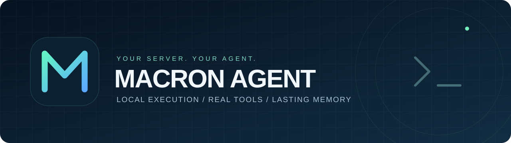

<div align="center">



# Macron Agent

**Your personal agent, on your own server.**

Write code · Automate work · Create files · Keep the conversation going

[](https://github.com/Metixpro/Macron-Agent/releases/latest)
[](https://github.com/Metixpro/Macron-Agent/actions/workflows/ci.yml)
[](LICENSE)
[](go.mod)

[فارسی](README.md) · [Server guide](SERVER.md) · [Downloads](https://github.com/Metixpro/Macron-Agent/releases/latest)

</div>

Macron is a personal Go agent that uses real tools to work on code, files, documents, the web and your server. Choose your model and keep control of your memory, files and configuration.

## Install

On Linux or macOS:

```bash
curl -fsSL https://raw.githubusercontent.com/Metixpro/Macron-Agent/main/install.sh | bash
```

The installer prepares the program and tools, checks the download and guides you through bot and model setup. Enter your bot token, owner ID and model credentials in the setup wizard.

Talk to the bot in a **private chat**. It answers configured owners only and does not operate in groups or channels. Progress appears in a native rich card with a checklist, expandable execution details, code blocks and a **Stop** button underneath. The final answer replaces the card. New text guides the active task; use `/queue next task` for a separate turn. Manage premium emoji packs and mappings under **Settings → Premium emoji**.

## Capabilities

| Area | Tools |
|---|---|
| Code and servers | Project inspection, file editing, shell/code execution, tests, Git and process management |
| Files and data | PDF, Word, Excel, CSV, charts, archives and data processing |
| Web | Search, page reading, downloads and browser automation |
| Memory and skills | Persistent conversations, history search, editable skills and learning |
| Background work | Scheduling, background tasks, task board and helper agents |
| Models and extensions | Custom providers, routing, multiple models, plugins and MCP |

Some capabilities need additional packages or service credentials. Check your installation with:

```bash
macron doctor --tools-only
```

## Run a task from the terminal

```bash
macron exec "Inspect this project and run its tests"
```

Configure the model through setup or `MACRON_API_URL`, `MACRON_MODEL` and `MACRON_API_KEY`. Each invocation gets its own workspace, whose path is printed to the terminal. OpenAI-compatible endpoints are supported, including local model servers. `exec` runs one task; an interactive terminal chat is not included yet.

## Telegram commands

| Command | Purpose |
|---|---|
| `/settings` | Admin panel |
| `/new` | New conversation |
| `/mode` | Fast or deep mode |
| `/memory` | Memory |
| `/files` | Files |
| `/reminders` | Reminders and schedules |
| `/tasks` | Background tasks |
| `/board` | Task board |
| `/search` | Conversation search |
| `/cancel` | Stop the active task |
| `/update` | Install a new GitHub release |

## Your memory, your files

The default home is `~/.macron`:

| Path | Contents |
|---|---|
| `SOUL.md` | Personality and response style |
| `USER.md` | Lasting owner information |
| `MEMORY.md` | Notes |
| `skills/` | Procedures and skills |
| `workspaces/` | Working files and outputs |

## Build from source

Requires Git, Make and **Go 1.26+**:

```bash
git clone https://github.com/Metixpro/Macron-Agent.git
cd Macron-Agent
make build
./bin/macron setup
```

To prepare tools and browser support from the checkout:

```bash
./install.sh --binary ./bin/macron --tools --browser-agent --no-setup
```

## Service and updates

```bash
macron service status
macron service restart
macron update
```

You can also use `/update` or the admin panel's Update button. Downloads come from GitHub Releases, with checksum verification, executable preflight and a retained previous binary. To publish a version, keep the source version and `vX.Y.Z` tag aligned.

## Development

```bash
make check
make build
```

The agent runs with its account's permissions. Keep tokens, keys, cookies and backups out of public repositories. See the [server guide](SERVER.md) for installation, services, dependencies and recovery.

## License

[MIT](LICENSE). Free to use, modify and distribute with the license notice retained.
