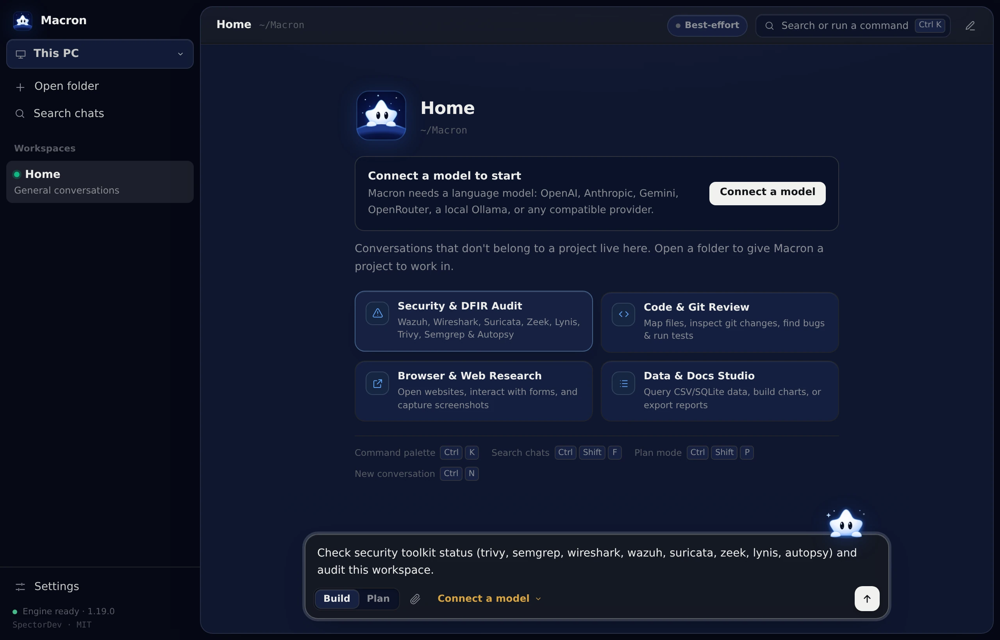
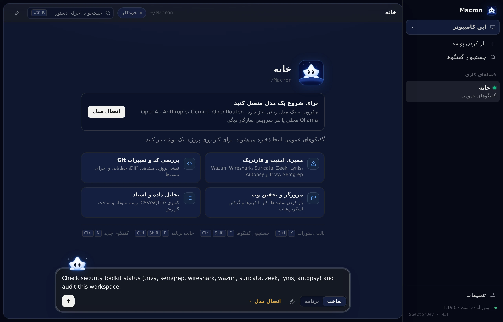
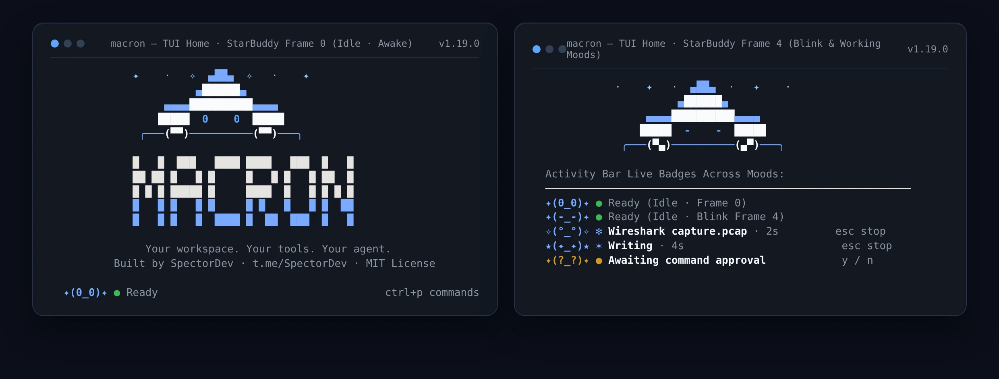

<div align="center">


<br>

**Your computer. Your tools. Your agent.**<br>
**کامپیوتر خودت، ابزارهای خودت، دستیار خودت.**

A personal AI agent built in Go for Windows, Linux, and macOS — across Desktop, Terminal, and Telegram.<br>
دستیار شخصی هوش مصنوعی با زبان Go برای ویندوز، لینوکس و مک؛ در اپلیکیشن دسکتاپ، ترمینال و تلگرام.

<br>

[](https://github.com/Metixpro/Macron-Agent/releases/latest)
[](https://github.com/Metixpro/Macron-Agent/actions/workflows/ci.yml)
[](go.mod)
[](https://t.me/SpectorDev)
[-55c9a5?style=flat-square&labelColor=111820)](LICENSE)
[](https://github.com/Metixpro/Macron-Agent/releases/latest)

<br>

**[راهنمای فارسی](#persian)** · **[English Guide](#english)** · **[SpectorDev Channel](https://t.me/SpectorDev)** · **[Downloads / دریافت](https://github.com/Metixpro/Macron-Agent/releases/latest)** · **[Server Guide](SERVER.md)** · **[Connections](docs/messengers-email.md)**

</div>

<br>

## Quick Start · شروع سریع

| Platform · سیستم‌عامل | Install · نصب | Launch · اجرا |
|---|---|---|
| **Windows** | [Download `Macron-Setup.exe`](https://github.com/Metixpro/Macron-Agent/releases/latest) or `irm …/install.ps1 \| iex` | Start menu → **Macron** · **Macron Terminal** |
| **Linux / macOS** | `curl -fsSL https://raw.githubusercontent.com/Metixpro/Macron-Agent/main/install.sh \| bash` | `macron desktop` · `macron` |
| **Server / سرور** | [Server setup guide](SERVER.md) | SSH from Desktop · Telegram · `macron exec` |

## Interface Preview · پیش‌نمایش محیط کار

| Desktop (`v1.19.0` — English · Midnight Cobalt, StarBuddy & Starter Cards) | Desktop (`v1.19.0` — فارسی · حالت راست‌به‌چپ هوشمند) |
|---|---|
|  |  |

<details>
<summary><b>Terminal TUI Preview · پیش‌نمایش محیط ترمینال (StarBuddy ANSI)</b></summary>
<br>
<p align="center">
  
</p>
</details>

> [!NOTE]
> **Privacy & control / حریم خصوصی و کنترل کامل:** Choose any model provider (OpenAI, Anthropic, Gemini, OpenRouter, DeepSeek, or a local Ollama/LM Studio/llama.cpp/vLLM endpoint auto-detected on your machine). Your conversations, memory, skills, and project files stay in your own profile. Cloud providers only receive the prompts you send them; use a local endpoint to keep inference completely on your machine.

---

<a id="persian"></a>

# راهنمای فارسی

**مکرون (Macron Agent)** یک دستیار شخصی هوش مصنوعی ساخته‌شده با **Go** است که مستقیماً روی سیستم یا سرور خودت اجرا می‌شود و با ابزارهای واقعی کار را پیش می‌برد: از بررسی و ویرایش کد، اجرای تست و مدیریت Git گرفته تا امنیت دفاعی، ساخت اسناد، جستجوی وب، اتصال به سرویس‌ها و مدیریت سرور.

### چرا مکرون؟

| ویژگی | توضیح |
|---|---|
| **سه محیط یکپارچه** | اپلیکیشن دسکتاپ بومی، محیط ترمینال تعاملی (TUI) و ربات تلگرام — همگی روی یک موتور واحد و رجیستری مشترک ۸۰ ابزار |
| **اپ دسکتاپ پیشرفته (`v1.19.0`)** | رابط کاربری دوزبانه **فارسی / انگلیسی** با طراحی **بوم شناور قاب‌دار (Framed Floating Canvas)**، **۵ پالت رنگی زنده + پشتیبانی پالت سفارشی (`~/.macron/themes/*.json`)**، آواتار SVG زنده و تعاملی **StarBuddy** روی باکس چت، **۴ کارت شروع سریع**، **تشخیص خودکار سرورهای مدل لوکال** (Ollama / LM Studio / llama.cpp / vLLM)، **مسیریابی هوشمند مدل سبک/قوی**، **رأی‌گیری چندمدلی (MoA)**، **تخمین هزینه دلاری توکن‌ها**، **جستجوی سراسری مکالمات (`Ctrl+Shift+F`)**، تست زنده اتصالات، خروجی عیب‌یابی امن و **آپدیتر خودکار با نوار پیشرفت زنده** |
| **مجموعه ابزار امنیتی و فارنزیک (`pkg/security`)** | ۸ ابزار تخصصی امنیت دفاعی و DFIR (**Wazuh**، **Wireshark**، **Suricata**، **Zeek**، **Lynis**، **Trivy**، **Semgrep** و **Autopsy**) با مصرف توکن فوق‌بهینه (بارگذاری تنبل ۰ توکنی در حالت عادی و خروجی خلاصه‌سازی‌شده) در هر سه محیط دسکتاپ، ترمینال و تلگرام |
| **امنیت و سندباکس واقعی در تمام سیستم‌عامل‌ها** | حالت‌های **Build** و **Plan** (فقط‌خواندنی)، تأیید دستورات پرخطر (Smart / Always ask / Never ask)، کنترل حالت اجرا (**Sandbox / Best-effort / Local**) با **سندباکس بومی ویندوز (`windows-job` با Win32 Job Objects)**، لینوکس (`bubblewrap` / Landlock) و مک (Seatbelt)، کپسول وضعیت ایزولاسیون در هدر و حالت موقت YOLO |
| **کار روی سرور بدون باز کردن پورت** | اتصال مستقیم دسکتاپ به سرورهای Linux/SSH و WSL روی تونل رمزشده SSH با تأیید اثر انگشت (`~/.ssh/known_hosts`) |
| **حافظه و مهارت‌های دست خودت** | تمام داده‌ها به صورت فایل‌های شفاف و قابل ویرایش (`SOUL.md`، `USER.md`، `MEMORY.md`، `skills/` و SQLite) داخل پروفایل خودت ذخیره می‌شوند |

---

### نصب و راه‌اندازی

#### لینوکس و مک (Linux / macOS)

```bash
curl -fsSL https://raw.githubusercontent.com/Metixpro/Macron-Agent/main/install.sh | bash
```

- در شروع، نوع نصب را انتخاب کن: **کاربر فعلی** (بدون نیاز به `sudo`) یا **سیستمی (root)**.
- نصب‌کننده سلامت دانلود را با `SHA256SUMS` بررسی می‌کند، محیط خصوصی پایتون و ابزارها را آماده می‌کند و مدل را تنظیم می‌کند. اتصال تلگرام اختیاری است و هر زمان با `macron telegram` قابل انجام است.

#### ویندوز (Windows)

فایل `Macron-Setup-….exe` را از [صفحه آخرین نسخه](https://github.com/Metixpro/Macron-Agent/releases/latest) دانلود و اجرا کن:
- یک نصب‌کننده واحد برای تمام سیستم‌های ویندوزی (`x64`، `x86` و `ARM64` را خودکار تشخیص می‌دهد).
- بدون نیاز به دسترسی ادمین در `%LOCALAPPDATA%\Programs\Macron` نصب می‌شود، هم **Macron Desktop** و هم **Macron Terminal** را نصب می‌کند و از بخش Apps ویندوز قابل حذف است.
- گفتگوها و تنظیمات در `~\.macron` نگهداری می‌شوند. به دلیل نداشتن امضای دیجیتال تجاری، در صورت نمایش هشدار SmartScreen روی **More info → Run anyway** کلیک کن.

یا نصب سریع از PowerShell:

```powershell
irm https://raw.githubusercontent.com/Metixpro/Macron-Agent/main/install.ps1 | iex
```

---

### ۱. اپلیکیشن دسکتاپ

در ویندوز از منوی Start گزینه **Macron** را باز کن و در لینوکس یا مک دستور زیر را بزن:

```bash
macron desktop
```

- **رابط کاربری مدرن با پالت‌های زنده و آواتار StarBuddy:** طراحی بوم شناور قاب‌دار با ۵ پالت آماده (Obsidian، Midnight Cobalt، Graphite Emerald، Warm Sand و Daylight Paper) + پشتیبانی پالت سفارشی، پشتیبانی کامل از انگلیسی و **فارسی (RTL)** با حفظ LTR برای کد و Diff، آواتار زنده StarBuddy روی باکس چت و ۴ کارت شروع سریع یک‌کلیکی.
- **سندباکس بومی و کنترل ایزولاسیون:** کپسول قابل کلیک در هدر و تنظیمات `Safety → Execution mode` برای جابه‌جایی بین `Sandbox` / `Best-effort` / `Local` با سندباکس بومی ویندوز (`windows-job`: محدودیت حافظه/پروسه، مسدودسازی کلیپ‌بورد و محیط ایزوله) و لینوکس (`bwrap`).
- **پیوست فایل و تصویر:** دکمه سنجاقک، کشیدن و رها کردن (Drag & Drop) روی پنجره، یا پیست مستقیم اسکرین‌شات و فایل با `Ctrl+V`. فایل‌ها در `.macron-uploads/` ذخیره و خودکار از Git مخفی می‌شوند.
- **پنل تغییرات Git و Diff رنگی:** مشاهده لحظه‌ای فایل‌های تغییریافته پروژه، بررسی Diff خط‌به‌خط رنگی و بازگردانی (Revert) دومرحله‌ای هر فایل در کنار پنل Plan.
- **منشن سریع فایل‌ها (`@file`):** با تایپ `@` در کادر پیام، جستجوی فازی بین فایل‌های پروژه انجام بده و مستقیماً به آن‌ها ارجاع بده.
- **مکالمات موازی و جستجوی سراسری:** ساخت، جابه‌جایی و حذف چند گفتگوی مستقل (Multi-thread) برای هر فضای کاری و جستجوی فوری در تمام گفتگوها با `Ctrl+Shift+F`.
- **تنظیمات جامع:** استودیو پروایدرها با **تشخیص خودکار مدل‌های لوکال**، مسیریابی هوشمند مدل، MoA، تخمین هزینه، مدیریت MCP و پلاگین‌ها، اسکیل‌ها، حافظه، تست زنده اتصالات، **خروجی عیب‌یابی بدون افشای رمز** و **آپدیت خودکار از GitHub Releases** با نوار پیشرفت و تأیید SHA-256.
- **کار روی سرور و WSL:** از منوی بالای نوار کناری (`This PC → Add a server…`) آدرس `user@server` را بده تا مکرون از طریق SSH رمزشده روی سرور اجرا شود؛ اگر روی سرور نصب یا به‌روز نباشد، خودش پیشنهاد نصب یا آپدیت می‌دهد.

---

### ۲. محیط ترمینال (TUI)

در پوشه هر پروژه اجرا کن:

```bash
macron
```

مکرون دستورالعمل پروژه را از `MACRON.md` (یا `AGENTS.md`) می‌خواند، پاسخ‌ها را زنده با Markdown نمایش می‌دهد، قدم‌های اجرا و Diffها را لیست می‌کند و سابقه گفتگوی هر پوشه را جداگانه نگه می‌دارد. اگر متن فارسی در ترمینال تو برعکس دیده شد (مثل Konsole، GNOME Terminal یا برخی کلاینت‌های SSH موبایل)، دستور `/rtl` را بزن.

<details>
<summary><b>فهرست میانبرها و فرمان‌های ترمینال</b></summary>

| کلید یا فرمان | کاربرد |
|---|---|
| `Enter` · `Ctrl+J` | ارسال پیام · خط جدید |
| `Esc` | توقف کار جاری |
| `Ctrl+P` | پالت جستجوی فرمان‌ها |
| `PageUp` · `PageDown` · `Ctrl+End` | مرور تاریخچه · بازگشت به انتهای گفتگو |
| `Tab` · `Shift+Tab` | جابه‌جایی بین **Build** و **Plan** (فقط‌خواندنی) |
| `/connect` · `/connections` | اتصال مدل یا سرویس · بررسی وضعیت اتصال‌ها بدون افشای رمز |
| `/provider` · `/model` | انتخاب پرووایدر و مدل فعال |
| `/effort` · `/context` · `/temperature` | تنظیم میزان فکر کردن مدل، پنجره context و دما |
| `/approvals` · `/yolo` | شیوه تأیید دستورات · اجرای بدون سؤال به مدت ۳۰ دقیقه |
| `/settings` | تنظیمات یکپارچه مدل، امنیت و ظاهر |
| `/mcp` | مدیریت سرورهای MCP و پلاگین‌ها (`/mcp add ...`) |
| `/new` · `/compact` · `/status` | گفتگوی تازه · خلاصه‌سازی سابقه · وضعیت |
| `/init` | ساخت فایل `MACRON.md` برای پروژه |
| `@مسیر` | اشاره به فایل پروژه (با تکمیل `Tab`) |
| `!دستور` | اجرای مستقیم دستور شل و ارسال خروجی به مدل در پیام بعدی |
| `/copy` · `/export` | کپی آخرین پاسخ · خروجی Markdown از گفتگو |
| `/theme` · `/rtl` | تغییر تم (`dark` / `light` / `auto`) · تنظیم نمایش فارسی |
| `/telegram` | اتصال و مدیریت ربات تلگرام |

</details>

---

### ۳. ربات تلگرام و اجرای بدون رابط

```bash
macron telegram                                      # راه‌اندازی و مدیریت سرویس ربات
macron telegram status|start|stop|restart|logs -f    # کنترل سریع سرویس
macron exec "پروژه را بررسی کن و تست‌ها را اجرا کن"  # اجرای تک‌مرحله‌ای برای اسکریپت و cron
```

- ربات فقط در **چت خصوصی (PV)** به مالکان مجاز پاسخ می‌دهد و روی `systemd` / `launchd` (یا پس‌زمینه در ویندوز با `macron service install`) اجرا می‌شود.
- برای تنظیم پیام‌رسان‌های بله، ایتا، روبیکا و ایمیل (Gmail OAuth / SMTP)، [راهنمای اتصال‌ها](docs/messengers-email.md) را ببین.

<details>
<summary><b>فهرست فرمان‌های تلگرام</b></summary>

| فرمان | کاربرد | فرمان | کاربرد |
|---|---|---|---|
| `/start` · `/help` | شروع و راهنما | `/board` · `/dashboard` | برد کارها و داشبورد وب |
| `/queue` | افزودن کار مستقل بعدی به صف | `/settings` · `/language` | پنل مدیریت و زبان ربات |
| `/new` · `/search` | گفتگوی تازه و جستجوی سابقه | `/update` | بروزرسانی مستقیم از گیت‌هاب |
| `/memory` · `/files` | مدیریت حافظه و فایل‌ها | `/learn` · `/teach` | مدیریت یادگیری و آموزش درس جدید |
| `/mode` · `/moa` | حالت پاسخ و رأی‌گیری چندمدلی | `/approve` · `/yolo` | تأیید دستور منتظر و سطح امنیت |
| `/reminders` · `/tasks` | زمان‌بندی و کارهای پس‌زمینه | `/cookies` | مدیریت کوکی دانلود |
| `/id` · `/me` | شناسه گفتگو و گزارش مصرف | `/cancel` | توقف کار فعلی |

</details>

---

### قابلیت‌ها و ابزارها

| حوزه | امکانات کلیدی |
|---|---|
| **کد و سرور** | تحلیل پروژه، ویرایش فایل، اجرای شل و کد، تست، Git و مدیریت پردازش‌ها |
| **اسناد و داده** | ساخت و خواندن Word و PowerPoint راست‌به‌چپ، PDF، Excel، CSV، نمودار، OCR فارسی، ترجمه فایل‌های بلند و مقایسه اسناد |
| **وب و مرورگر** | جستجو، خواندن صفحات، دانلود رسانه و مرورگر خودکار (Playwright) |
| **داده و توسعه** | کوئری فقط‌خواندنی PostgreSQL / MySQL / SQLite، کرنل ماندگار پایتون، داشبورد HTML، فراخوانی OpenAPI و دیپلوی با Rollback |
| **حافظه و کارهای طولانی** | حافظه ماندگار، یادگیری از اجراها، زمان‌بندی، کارهای پس‌زمینه، برد کار و زیرعامل‌ها |
| **بورس و بازار** | اطلاعات نمادهای TSETMC (قیمت، حجم، EPS، صف و کدال)، شاخص‌ها، هشدار قیمت و گزارش صبحگاهی |
| **امنیت و فارنزیک (`pkg/security`)** | ۸ ابزار دفاعی و فارنزیک با مصرف توکن بهینه در هر سه محیط: **Wazuh** (SIEM/FIM/SCA)، **Wireshark** (`tshark` + تحلیل‌گر بومی PCAP)، **Suricata**، **Zeek**، **Lynis**، **Trivy**، **Semgrep** و **Autopsy** |
| **اتصال‌ها و افزونه‌ها** | MCP، پلاگین‌ها، ایمیل، تقویم `.ics`، بله، ایتا، روبیکا، Slack، Discord، WhatsApp، S3/WebDAV، Notion، Trello، Todoist و GitHub (با تست زنده اتصال و تأیید قبل از ارسال بیرونی) |

وضعیت ابزارهای نصب‌شده را هر زمان با این دستور بررسی کن:

```bash
macron doctor --tools-only
```

---

### ساختار حافظه، آپدیت، حذف و توسعه

| مسیر (`~/.macron` یا `/var/lib/macron`) | محتوا |
|---|---|
| `SOUL.md` | شخصیت و لحن پاسخ‌گویی |
| `USER.md` | اطلاعات ماندگار مالک |
| `MEMORY.md` | یادداشت‌ها و حافظه دستیار |
| `skills/` | مهارت‌ها و دستورالعمل‌های قابل ویرایش |
| `workspaces/` | فایل‌ها و خروجی‌های کارها |

```bash
# بروزرسانی از GitHub Releases (با تأیید SHA-256 و نگهداری باینری قبلی)
macron update

# حذف نصب (برای نگه‌داشتن داده‌ها --keep-data اضافه کن)
macron uninstall --dry-run
macron uninstall

# ساخت از سورس (نیاز به Git، Make و Go 1.26+)
git clone https://github.com/Metixpro/Macron-Agent.git
cd Macron-Agent
make build
make check        # تست و بررسی تطابق باندل UI
make audit        # تحلیل ایستا و بررسی آسیب‌پذیری‌ها
make test-race    # تست‌های رگرسیون همراه با race detector
```

برای آماده‌سازی ابزارها و مرورگر از سورس: `./install.sh --binary ./bin/macron --tools --browser-agent --no-setup`. جزئیات استقرار سرور و بازیابی در [SERVER.md](SERVER.md) آمده است.

---

<a id="english"></a>

# English Guide

**Macron Agent** is a personal AI agent written in **Go** that runs on your own machine or server and gets real work done using real tools — inspecting and editing repositories, running tests, managing Git, running defensive security audits, building documents, browsing the web, connecting to external services, and administering remote servers.

### Highlights

| Area | What you get |
|---|---|
| **Three unified interfaces** | Native Desktop app, interactive Terminal (TUI), and Telegram bot — all powered by the same core engine and shared 80-tool registry |
| **Desktop App (`v1.19.0`)** | Framed floating-canvas shell with **5 built-in live Theme Palettes + custom `~/.macron/themes/*.json`**, interactive peeking SVG **StarBuddy** mascot, **4 one-click Starter Action Cards**, **English & Persian (`فارسی`)** RTL UI, **Local LLM Auto-Discovery** (Ollama / LM Studio / llama.cpp / vLLM), **Per-Model Custom Provider Studio**, **Smart Light/Strong Routing**, **Multi-Model Voting (MoA)**, live **USD Cost Estimator**, **Global Session Search (`Ctrl+Shift+F`)**, live connection testing, privacy-safe diagnostics export, and **SHA-256 GitHub Auto-Updater with live progress bar** |
| **Defensive Security & DFIR (`pkg/security`)** | 8 specialized security & forensics tools (**Wazuh**, **Wireshark**, **Suricata**, **Zeek**, **Lynis**, **Trivy**, **Semgrep**, and **Autopsy**) with 0-token idle deferred loading and compact bounded output across Desktop, TUI, and Telegram |
| **Cross-platform safety & sandbox** | **Build** vs read-only **Plan** modes, granular command approvals (`Smart` / `Always ask` / `Never ask`), execution isolation (**Sandbox / Best-effort / Local**) with **native Windows Job-Object Sandbox (`windows-job`)**, Linux `bubblewrap`/Landlock, and macOS Seatbelt, clickable header isolation capsule, and timed 30-minute YOLO toggle |
| **Zero-port remote servers** | Launch and control Macron on remote Linux servers or WSL directly from Desktop over encrypted SSH with host-key verification (`~/.ssh/known_hosts`) |
| **Transparent local memory** | Conversations, personality, notes, and skills stay in plain editable files (`SOUL.md`, `USER.md`, `MEMORY.md`, `skills/`) and local SQLite under your profile |

---

### Installation

#### Linux & macOS

```bash
curl -fsSL https://raw.githubusercontent.com/Metixpro/Macron-Agent/main/install.sh | bash
```

- Pick **current user** (no `sudo` required) or **system/root** install.
- Verifies downloads against `SHA256SUMS`, provisions an isolated Python environment for document/media tools, and walks through model setup. Telegram setup is optional and can be run anytime with `macron telegram`.

#### Windows

Download and run `Macron-Setup-….exe` from the [latest release](https://github.com/Metixpro/Macron-Agent/releases/latest):
- One universal installer for every Windows PC (auto-detects `x64`, `x86`, and `ARM64`).
- Installs without admin rights into `%LOCALAPPDATA%\Programs\Macron` with both **Macron** (desktop) and **Macron Terminal**, integrates with Start Menu and Windows Apps uninstall, and keeps settings/history in `~\.macron`.
- Because the installer is not commercially code-signed, Windows SmartScreen may prompt — click **More info → Run anyway**.

Or install directly via PowerShell:

```powershell
irm https://raw.githubusercontent.com/Metixpro/Macron-Agent/main/install.ps1 | iex
```

---

### 1. Desktop App

Launch **Macron** from the Start Menu on Windows (uses WebView2, falling back to Edge), or run `macron desktop` on Linux and macOS:

- **Modern framed shell, live palettes & StarBuddy mascot:** Floating-canvas workspace with 5 built-in Theme Palettes (Obsidian, Midnight Cobalt, Graphite Emerald, Warm Sand, Daylight Paper) + custom JSON palettes, interactive SVG StarBuddy peeking over the composer, 4 one-click starter cards, and live **English / Persian (`فارسی`)** RTL mirroring (keeping code, diffs, paths, and shortcuts LTR).
- **Native Sandbox & isolation control:** Clickable header isolation capsule and `Settings → Safety → Execution mode` (`Sandbox` / `Best-effort` / `Local`), backed by native **Windows Job Objects (`windows-job`)** on Windows and `bwrap` on Linux.
- **Attachments & screenshots:** Attach files or images via the paperclip button, window Drag & Drop, or `Ctrl+V` clipboard paste. Uploads are stored under `.macron-uploads/` and automatically excluded from Git.
- **Git Changes & Unified Diff:** Inspect live workspace modifications, read syntax-colored diffs, and revert individual files with two-step confirmation right alongside the Plan panel.
- **`@file` fuzzy mentions:** Type `@` in the composer to search and reference project files directly.
- **Multi-thread workspaces & global search:** Create, switch between, and delete independent conversation threads per project folder with isolated SQLite memory, and search across all history with `Ctrl+Shift+F`.
- **Built-in management & auto-updates:** Configure custom model providers with **local LLM auto-discovery**, smart routing, MoA, MCP servers & plugins, Skills, Memory (`MEMORY.md` / `USER.md`), live Service Connection tests, **privacy-safe diagnostics export**, and one-click GitHub Releases updates right inside Settings.
- **Remote servers & WSL:** Choose **Add a server…** in the sidebar header (`user@server`) to work on remote machines over encrypted SSH — no exposed ports required. If Macron is missing or outdated remotely, the app offers to install or update it for you.

---

### 2. Terminal Interface (TUI)

Run inside any project folder:

```bash
macron
```

Macron reads project instructions from `MACRON.md` (or `AGENTS.md`), streams Markdown answers, lists tool calls and diffs as they run, asks approval before risky commands, and preserves per-folder history. On terminals that reorder RTL text themselves (such as Konsole, GNOME Terminal, or mobile SSH clients), toggle `/rtl`.

<details>
<summary><b>Terminal shortcuts & slash commands</b></summary>

| Key or command | Action |
|---|---|
| `Enter` · `Ctrl+J` | Send · insert newline |
| `Esc` | Interrupt current job |
| `Ctrl+P` | Searchable command palette |
| `PageUp` · `PageDown` · `Ctrl+End` | Browse history · jump to latest output |
| `Tab` · `Shift+Tab` | Toggle **Build** / **Plan** (read-only tools) |
| `/connect` · `/connections` | Connect model or service · inspect status without exposing secrets |
| `/provider` · `/model` | Switch active provider or model |
| `/effort` · `/context` · `/temperature` | Configure reasoning effort, context window, and temperature |
| `/approvals` · `/yolo` | Configure command approval policy · 30-minute auto-approve |
| `/settings` | Unified settings menu |
| `/mcp` | Manage MCP servers & plugins (`/mcp add ...`) |
| `/new` · `/compact` · `/status` | Fresh conversation · compact history · session status |
| `/init` | Generate `MACRON.md` for the project |
| `@path` | Reference a project file (`Tab` autocompletes) |
| `!command` | Run a shell command directly; Macron sees its output on the next turn |
| `/copy` · `/export` | Copy last answer · export conversation to Markdown |
| `/theme` · `/rtl` | Switch theme (`dark` / `light` / `auto`) · toggle RTL shaping |
| `/telegram` | Configure and manage the Telegram bot |

</details>

---

### 3. Telegram Bot & Headless Mode

```bash
macron telegram                                      # interactive setup & service manager
macron telegram status|start|stop|restart|logs -f    # manage background service
macron exec "Inspect this project and run its tests" # one-shot execution for scripts & cron
```

- Operates strictly in **private chat** with configured owners, showing live progress cards with checklists, collapsible tool details, and a Stop button.
- On Windows, `macron service install` manages the per-user background process and sign-in startup (`macron logs -f` streams logs natively without Unix utilities).
- See [Messenger & Email Connections](docs/messengers-email.md) for Bale, Eitaa, Rubika, Gmail OAuth, and SMTP setup.

<details>
<summary><b>Telegram bot commands</b></summary>

| Command | Purpose | Command | Purpose |
|---|---|---|---|
| `/start` · `/help` | Intro and help | `/board` · `/dashboard` | Task board and web dashboard |
| `/queue` | Queue a separate next task | `/settings` · `/language` | Admin panel and bot language |
| `/new` · `/search` | Fresh chat & search past chats | `/update` | Update directly from GitHub |
| `/memory` · `/files` | Manage memory & files | `/learn` · `/teach` | Manage learning & teach lessons |
| `/mode` · `/moa` | Response mode & multi-model voting | `/approve` · `/yolo` | Approve pending command & policy |
| `/reminders` · `/tasks` | Schedules & background tasks | `/cookies` | Manage download cookies |
| `/id` · `/me` | Chat ID & usage summary | `/cancel` | Stop current task |

</details>

---

### Capabilities

| Area | Built-in Tools |
|---|---|
| **Code & servers** | Project inspection, file editing, shell/code execution, testing, Git, and process management |
| **Documents & media** | RTL-aware Word & PowerPoint generation, PDF, Excel, CSV, charts, Persian OCR, long-file translation, diagrams, and document diffing |
| **Web & browser** | Search, page extraction, media downloads, and headless browser automation |
| **Data & dev** | Read-only PostgreSQL / MySQL / SQLite queries, persistent Python kernel, HTML dashboards, statistics/forecasting, OpenAPI calls, and rollback-capable deploys |
| **Memory & autonomy** | Persistent conversations, history search, editable skills, learning, schedules, background jobs, task board, and sub-agents |
| **Markets** | Tehran Stock Exchange (TSETMC) prices, volume, EPS, order book, Codal filings, indices, price alerts, and morning briefings |
| **Security & DFIR (`pkg/security`)** | Token-efficient defensive security & forensics across Desktop, TUI, and Telegram: **Wazuh** SIEM/FIM/SCA, **Wireshark** (`tshark` + pure-Go PCAP fallback), **Suricata** IDS (`eve.json`/`fast.log`/PCAP), **Zeek** NSM log analysis, **Lynis** hardening audits, **Trivy** CVE/misconfig/secret scanner, **Semgrep** SAST, and **Autopsy** SQLite digital forensics |
| **Connections & extensions** | MCP servers, plugins, Email, `.ics` calendars, Bale, Eitaa, Rubika, Slack, Discord, WhatsApp, S3/R2/WebDAV, Notion, Trello, Todoist, and GitHub (with live connection testing across Desktop, TUI, and Telegram) |

Check tool and environment readiness anytime:

```bash
macron doctor --tools-only
```

---

### Memory Layout, Updates, Uninstall & Development

| Path (`~/.macron` or `/var/lib/macron`, override with `--home`) | Purpose |
|---|---|
| `SOUL.md` | Agent personality and response style |
| `USER.md` | Persistent owner profile |
| `MEMORY.md` | Saved notes and facts |
| `skills/` | Editable procedures and skills |
| `workspaces/` | Working files and job outputs |

```bash
# Update from GitHub Releases (SHA-256 verified, preflight checked, previous binary kept)
macron update

# Uninstall cleanly (add --keep-data to preserve memory/config, or --yes to skip confirmation)
macron uninstall --dry-run
macron uninstall

# Build & test from source (requires Git, Make, and Go 1.26+)
git clone https://github.com/Metixpro/Macron-Agent.git
cd Macron-Agent
make build
make check        # tests, installer syntax, and UI bundle verification
make audit        # staticcheck + govulncheck
make test-race    # regression suite with Go race detector
```

To install optional Python/browser tools from a source checkout, run `./install.sh --binary ./bin/macron --tools --browser-agent --no-setup`. See [SERVER.md](SERVER.md) for deployment, services, and recovery, and [docs/testing.md](docs/testing.md) for live-model testing.

---

<div align="center">

Developed by **[SpectorDev Team](https://t.me/SpectorDev)** (`@SpectorDev`) · Licensed under the **[MIT License](LICENSE)** · Built with Go & React

</div>
