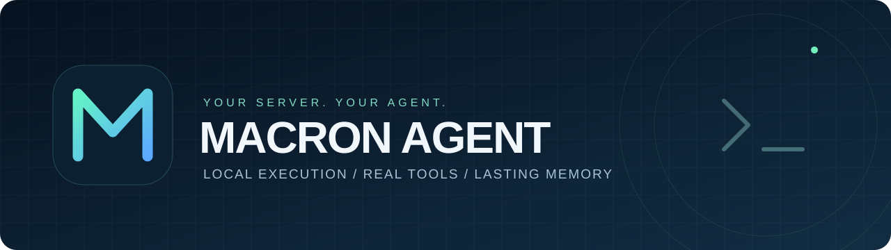
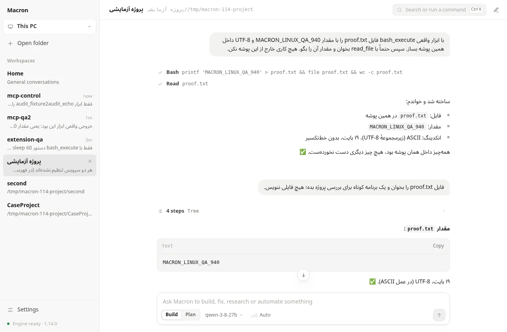
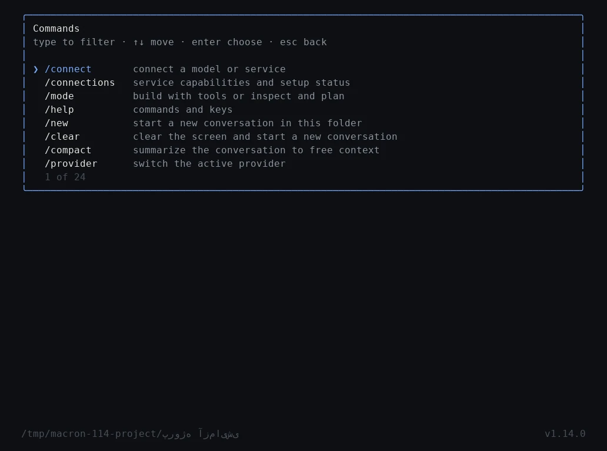

<div align="center">



# Macron Agent · مکرون ایجنت

**Your computer. Your tools. Your agent.**<br>
**کامپیوتر خودت، ابزارهای خودت، دستیار خودت.**

A personal AI agent for Windows, Linux and macOS — desktop, terminal and messaging.<br>
دستیار شخصی برای ویندوز، لینوکس و مک؛ در دسکتاپ، ترمینال و پیام‌رسان.

[](https://github.com/Metixpro/Macron-Agent/releases/latest)
[](https://github.com/Metixpro/Macron-Agent/actions/workflows/ci.yml)
[](LICENSE)
[](go.mod)
[](https://github.com/Metixpro/Macron-Agent/releases/latest)

[فارسی](#persian) · [English](#english) · [Downloads / دریافت](https://github.com/Metixpro/Macron-Agent/releases/latest) · [Server guide](SERVER.md) · [Connections](docs/messengers-email.md)

</div>

| Get started · شروع | Choose your interface · محیط کار |
|---|---|
| **Windows** — [Download the installer / دریافت نصب‌کننده](https://github.com/Metixpro/Macron-Agent/releases/latest) | Start menu → **Macron** (desktop) · **Macron Terminal** |
| **Linux / macOS** — installer below / نصب‌کنندهٔ پایین | `macron desktop` · `macron` |
| **Server / سرور** — [Setup guide / راهنما](SERVER.md) | SSH from desktop · Telegram · `macron exec` |


| Desktop · دسکتاپ | Terminal · ترمینال |
|---|---|
|  |  |


Choose your model provider, work in a project folder, and keep conversations, memory and skills in your own profile. Cloud providers receive the requests you send them; use a local endpoint when you want model inference on your own machine. Some tools need additional packages or service credentials.

مدل را خودت انتخاب کن؛ گفتگوها، حافظه و مهارت‌ها در پروفایل خودت می‌مانند. با پرووایدر ابری، درخواست‌ها به همان سرویس فرستاده می‌شوند؛ برای اجرای مدل روی دستگاه خودت از endpoint محلی استفاده کن. بعضی ابزارها به وابستگی یا حساب سرویس جدا نیاز دارند.

---

<a id="persian"></a>

## فارسی

مکرون یک عامل شخصی با Go است که روی ماشین خودت اجرا می‌شود و کار را با ابزارهای واقعی پیش می‌برد: از بررسی پروژه و اجرای تست تا ساخت سند، جستجوی وب و مدیریت سرور. مدل را خودت انتخاب می‌کنی؛ حافظه، فایل‌ها و تنظیمات در اختیار خودت هستند.

## نصب و شروع

روی Linux یا macOS:

```bash
curl -fsSL https://raw.githubusercontent.com/Metixpro/Macron-Agent/main/install.sh | bash
```

اول نوع نصب را انتخاب کن: **کاربر فعلی** یا **سیستمی با روت**. نصب‌کننده مسیرها را نشان می‌دهد، صحت دانلود را بررسی می‌کند و مدل را تنظیم می‌کند؛ اتصال تلگرام اختیاری است و همان‌جا یا بعداً با `macron telegram` انجام می‌شود.

نصب کاربری به `sudo` نیاز ندارد. کتابخانه‌های پایتون داخل محیط خصوصی نصب می‌شوند؛ اگر Python مناسب موجود نباشد، نصب‌کننده آن را هم آماده می‌کند. ابزارهای سیستمی اختیاریِ نصب‌نشده در گزارش مشخص می‌شوند.

روی Windows فایل `Macron-Setup-…exe` را از [آخرین نسخه](https://github.com/Metixpro/Macron-Agent/releases/latest) بگیر و اجرا کن: یک نصب‌کننده برای همهٔ ویندوزها (۶۴ بیتی، ۳۲ بیتی یا ARM را خودش تشخیص می‌دهد؛ ربطی به اینتل یا AMD بودن پردازنده ندارد). بدون دسترسی ادمین در `%LOCALAPPDATA%\Programs\Macron` نصب می‌شود، برنامهٔ دسکتاپ و ترمینال را با هم نصب می‌کند، به منوی Start (و اگر بخواهی دسکتاپ و `PATH`) اضافه می‌کند و از «Apps» ویندوز حذف می‌شود؛ گفتگوها و تنظیمات در `~\.macron` می‌مانند. چون فایل امضای دیجیتال ندارد، ویندوز ممکن است هشدار SmartScreen بدهد: More info و بعد Run anyway.

یا در PowerShell (همان پوشه، همان دو برنامه، بدون پنجرهٔ نصب):

```powershell
irm https://raw.githubusercontent.com/Metixpro/Macron-Agent/main/install.ps1 | iex
```

### برنامهٔ دسکتاپ

روی Windows از منوی Start باز کن؛ روی Linux و macOS بزن `macron desktop`. پنجره‌ای مستقل باز می‌شود (روی Windows با WebView2؛ اگر نبود در Edge) با همهٔ امکانات ترمینال: پاسخ زنده، قدم‌های هر کار که چندتایی‌ها زیر یک سطر جمع می‌شوند، چک‌لیست و زیرعامل‌ها حین کار، فایل‌هایی که مکرون برایت می‌فرستد (هر نوعی: عکس و ویدیو با پیش‌نمایش، بقیه با باز کردن، نشان دادن در پوشه و ذخیره)، تأیید دستورهای پرخطر، Build و Plan، انتخاب مدل، و پوشهٔ هر پروژه با گفتگوی خودش. متن فارسی و جدول‌ها راست‌به‌چپ نمایش داده می‌شوند.

بار اول برنامه چند قدم کوتاه راه‌اندازی دارد: سرویس مدل (OpenAI، Anthropic، Gemini، OpenRouter، DeepSeek، Ollama یا هر سرویس سازگار)، کلید و انتخاب مدل از فهرست خود سرویس (قبل از ذخیره امتحان می‌شود)، و پوشهٔ کار. برای کار روی سرور از منوی «This PC» یک سرور SSH اضافه کن؛ اگر مکرون آنجا نصب نباشد یا قدیمی باشد، برنامه پیشنهاد می‌دهد همان‌جا نصب یا به‌روزش کند. `Ctrl+K` همهٔ کارها، تم‌ها و پوشه‌ها را جست‌وجو می‌کند.

روی Windows، مکرون دستورها را با PowerShell اجرا می‌کند (PowerShell 7 اگر نصب باشد) و همان قواعد تأیید را برای فرمان‌های پرخطر ویندوزی هم دارد.

در تنظیمات برنامه effort، پنجرهٔ context و دمای مدل هم تنظیم می‌شود و دکمهٔ effort کنار نام مدل زیر کادر پیام است. سرورهای MCP و پلاگین‌ها هم از تنظیمات اضافه، روشن و خاموش می‌شوند؛ ابزارهایشان در برنامه، ترمینال و تلگرام در دسترس مکرون است.

**کار روی سرور:** از منوی بالای نوار کناری «Add a server…» را بزن و `user@server` را بده. برنامه مکرونِ نصب‌شده روی سرور را از راه SSH بالا می‌آورد و از همان اتصال رمزشده با آن حرف می‌زند؛ هیچ پورتی روی اینترنت باز نمی‌شود. بار اول اثر انگشت کلید سرور را نشان می‌دهد و در `~/.ssh/known_hosts` نگه می‌دارد و اگر عوض شود اتصال را رد می‌کند. کلید SSH از ssh-agent یا `~/.ssh` خوانده می‌شود؛ رمز عبور فقط برای همان جلسه نگه داشته می‌شود. مکرونِ داخل WSL هم از همین منو وصل می‌شود. روی سرور کافی است مکرون نصب و به‌روز باشد (`macron update`).

### در ترمینال

در پوشهٔ هر پروژه فقط بزن:

```bash
macron
```

یک محیط ترمینالی تعاملی باز می‌شود: پاسخ‌ها زنده و با Markdown نمایش داده می‌شوند، هر قدم (دستور، خروجی آخرش، فایل نوشته‌شده، diff ویرایش) زیر هم می‌آید، چک‌لیست کار به‌روز می‌شود و دستورهای پرخطر قبل از اجرا با یک کادر تأیید از تو پرسیده می‌شوند. مکرون در همان پوشه کار می‌کند و دستورالعمل پروژه را از `MACRON.md` (یا `AGENTS.md`) می‌خواند. گفتگوی هر پوشه ماندگار است: دفعهٔ بعد که `macron` را آنجا بزنی، کار را با سابقهٔ دقیقش ادامه می‌دهد.

| کلید یا فرمان | کار |
|---|---|
| `Enter` · `Ctrl+J` | ارسال · خط جدید |
| `Esc` | توقف کار جاری |
| `Ctrl+P` | جست‌وجوی فرمان‌ها؛ فهرست محدود و قابل پیمایش |
| `PageUp` · `PageDown` · `Ctrl+End` | مرور تاریخچه · برگشت به آخر گفتگو |
| `/provider` | انتخاب پرووایدر فعال |
| `Tab` · `Shift+Tab` | جابه‌جایی بین Build و Plan؛ در Plan فقط ابزارهای خواندنی فعال‌اند |
| `/connect` · `/connections` | اتصال مدل یا سرویس · وضعیت تنظیمات بدون نمایش رمزها |
| `/model` · `/approvals` · `/yolo` | تغییر مدل · شیوهٔ تأیید دستورها · اجرای بی‌سؤال تا ۳۰ دقیقه |
| `/effort` · `/context` · `/temperature` | میزان فکر کردن مدل (auto تا ultracode) · پنجرهٔ context · دما؛ همه برای پرووایدر فعال |
| `/settings` | مدل، effort، context، دما، تأیید دستورها و ظاهر در یک فهرست |
| `/mcp` | سرورهای MCP و پلاگین‌ها: فهرست، افزودن (`/mcp add github npx -y …`)، روشن و خاموش، حذف |
| `/new` · `/compact` · `/status` | گفتگوی تازه · خلاصه‌کردن سابقه · وضعیت |
| `/init` | نوشتن `MACRON.md` برای پروژه |
| `@مسیر` | اشاره به یک فایل پروژه؛ `Tab` مسیر را کامل می‌کند |
| `!دستور` | اجرای مستقیم یک دستور شل؛ مکرون خروجی‌اش را در پیام بعدی می‌بیند |
| `/copy` · `/export` | کپی آخرین جواب در کلیپ‌بورد · ذخیرهٔ گفتگو در یک فایل Markdown |
| `/theme` | رنگ‌ها برای ترمینال تیره یا روشن (`dark` · `light` · `auto`) |
| `/telegram` | اتصال و مدیریت ربات تلگرام |

ورودی و نوار رنگی وضعیت در صفحهٔ گفتگو پایین ترمینال ثابت‌اند؛ تاریخچه جداگانه پیمایش می‌شود. متن فارسی در لایهٔ نمایش شکل‌دهی و راست‌به‌چپ می‌شود و متن اصلیِ ارسالی به مدل تغییر نمی‌کند. اگر فارسی برعکس دیده شد (ترمینال‌هایی که خودشان راست‌به‌چپ را می‌چینند، مثل بیشتر برنامه‌های SSH موبایل، Konsole و GNOME Terminal)، `/rtl` را بزن؛ انتخابت ذخیره می‌شود.

صفحهٔ شروع، مدل و حالت فعال را نشان می‌دهد و با عرض ترمینال یا موبایل هماهنگ می‌شود. برای تنظیم مدل از `/connect model` استفاده کن. می‌توانی در چت هم بگویی «بله را وصل کن» یا «اتصال جی‌میل را بررسی کن»؛ مکرون ابزار اتصال را پیدا می‌کند، تنظیمات موجود را بررسی می‌کند و فقط اطلاعات لازم را می‌پرسد. ذخیرهٔ توکن با تأیید اتصال فرق دارد؛ بررسی اتصال بدون ارسال پیام انجام می‌شود.

جزئیات چت و اجرای ابزار در بله و روبیکا، محدودیت ایتایار و تنظیم Gmail در [راهنمای اتصال‌ها](docs/messengers-email.md) آمده است.

### در تلگرام

```bash
macron telegram
```

مرحله‌به‌مرحله توکن ربات (از @BotFather) و آیدی تو را می‌گیرد (کافی است به ربات پیام بدهی تا خودش ببیند)، تنظیمات را ذخیره و ربات را پس‌زمینه اجرا می‌کند: با systemd یا launchd به‌صورت سرویس که خودش بالا می‌آید، و جایی که سرویس سیستم نیست، به‌صورت پردازش پس‌زمینه. دفعه‌های بعد همین فرمان وضعیت را نشان می‌دهد و گزینهٔ راه‌اندازی دوباره، توقف، لاگ و تغییر ربات را می‌دهد. `macron telegram status|start|stop|restart|logs -f` هم هست.

در **پیوی ربات** پیام بده. مکرون فقط به مالکان تنظیم‌شده پاسخ می‌دهد و در گروه و کانال کار نمی‌کند.

## چه کارهایی می‌کند؟

| بخش | امکانات |
|---|---|
| کد و سرور | خواندن و ویرایش پروژه، اجرای دستور و کد، تست، Git و مدیریت پردازش‌ها |
| فایل و داده | PDF، Word، Excel، CSV، نمودار، آرشیو و پردازش داده |
| وب | جستجو، خواندن صفحات، دانلود و مرورگر خودکار |
| حافظه و مهارت | گفتگوی ماندگار، جستجوی سابقه، مهارت‌های قابل‌ویرایش و یادگیری از اجراها |
| کارهای طولانی | زمان‌بندی، اجرای پس‌زمینه، برد کار و دستیارهای کمکی |
| مدل و افزونه | پروایدر دلخواه، مسیریابی، اجرای چندمدلی، پلاگین و MCP |
| ویجت تلگرام | داشبورد، فرم، ماشین‌حساب و بازی تعاملی داخل پیام، با جواب از اسکریپت‌های روی سرور خودت |
| بورس و بازار | قیمت، حجم، EPS، صف و نامه‌های کدال هر نماد از TSETMC، شاخص‌ها، هشدار قیمت و گزارش صبحگاهی |
| اسناد و رسانه | ساخت Word و PowerPoint واقعی (راست‌به‌چپ)، OCR فارسی، ترجمهٔ فایل‌های بلند، دیاگرام، مقایسهٔ اسناد، صورت‌جلسه از متن پیاده‌شده |
| داده و توسعه | کوئری فقط‌خواندنی روی PostgreSQL، MySQL و SQLite، کرنل پایتون ماندگار، داشبورد HTML، آمار و پیش‌بینی، فراخوانی OpenAPI، دیپلوی با بازگشت خودکار |
| اتصال‌ها | ایمیل، تقویم .ics، بله، ایتا، روبیکا، اسلک، دیسکورد، واتساپ، S3 و WebDAV، Notion، Trello، Todoist و GitHub؛ هر ارسالی اول از تو پرسیده می‌شود |

بعضی ابزارها به پکیج، مدل یا سرویس جدا نیاز دارند. وضعیت محیط را با این فرمان بررسی کن:

```bash
macron doctor --tools-only
```

## اجرای یک تکلیف بدون رابط

برای اسکریپت و cron:

```bash
macron exec "این پروژه را بررسی کن و تست‌هایش را اجرا کن"
```

آدرس مدل، نام مدل و کلید را در راه‌انداز یا متغیرهای `MACRON_API_URL`، `MACRON_MODEL` و `MACRON_API_KEY` تنظیم کن. هر اجرا فضای کار جداگانه دارد و مسیر آن در ترمینال نمایش داده می‌شود. از endpoint سازگار با OpenAI می‌توان استفاده کرد؛ با endpoint محلی، پردازش مدل هم روی ماشین خودت است.

## کنترل از تلگرام

| فرمان | کاربرد |
|---|---|
| `/start` | شروع و معرفی |
| `/help` | راهنما |
| `/queue` | کار مستقل بعدی |
| `/new` | گفتگوی تازه |
| `/memory` | حافظه و فایل‌ها |
| `/mode` | انتخاب حالت پاسخ |
| `/files` | مدیریت فایل‌ها |
| `/cookies` | مدیریت کوکی دانلود |
| `/reminders` | یادآورها و زمان‌بندی |
| `/tasks` | کارهای پس‌زمینه |
| `/search` | جستجوی گفتگوهای قبلی |
| `/board` | برد کارها |
| `/dashboard` | داشبورد وب |
| `/settings` | پنل مدیریت |
| `/update` | بروزرسانی از گیت‌هاب |
| `/learn` | مدیریت یادگیری |
| `/teach` | یاد دادن یک درس |
| `/moa` | رأی‌گیری چندمدلی |
| `/approve` | تأیید دستور منتظر |
| `/yolo` | تنظیم تأیید دستورات |
| `/language` | زبان ربات |
| `/id` | شناسه کاربر و گفتگو |
| `/me` | وضعیت حساب و مصرف |
| `/cancel` | توقف کار فعلی |

## حافظه‌ای که دست خودت است

اطلاعات نصب کاربری در `~/.macron` و نصب سیستمی در `/var/lib/macron` نگهداری می‌شوند. مسیر دلخواه با `--home` قابل انتخاب است:

| فایل یا پوشه | محتوا |
|---|---|
| `SOUL.md` | شخصیت و سبک پاسخ |
| `USER.md` | اطلاعات ماندگار مالک |
| `MEMORY.md` | یادداشت‌ها |
| `skills/` | مهارت‌ها و دستورالعمل‌ها |
| `workspaces/` | فایل‌ها و خروجی کارها |

## ساخت از سورس

به Git، Make و **Go 1.26+** نیاز داری:

```bash
git clone https://github.com/Metixpro/Macron-Agent.git
cd Macron-Agent
make build
./bin/macron
```

برای آماده‌کردن ابزارها و مرورگر از همان سورس:

```bash
./install.sh --binary ./bin/macron --tools --browser-agent --no-setup
```

## مدیریت و آپدیت

```bash
macron telegram status
macron telegram restart
macron update
```

از تلگرام هم `/update` یا دکمهٔ بروزرسانی پنل را بزن. نسخه از Release گیت‌هاب دریافت می‌شود؛ checksum و اجرای اولیه بررسی و باینری قبلی نگه داشته می‌شود. برای انتشار نسخهٔ تازه، شمارهٔ نسخه و تگ `vX.Y.Z` باید هماهنگ باشند.

در ویندوز هم همین فرمان‌ها را در PowerShell اجرا کن. `macron doctor --offline` تنظیمات دسکتاپ و ابزارهای ویندوز را بررسی می‌کند. `macron service install` ربات تلگرام را در پس‌زمینه اجرا و شروع آن هنگام ورود همین کاربر به ویندوز را ثبت می‌کند؛ `status`، `stop`، `restart` و `uninstall` هم کار می‌کنند. `macron logs -f` لاگ را بدون نیاز به ابزار لینوکسی می‌خواند. این اجرا تا زمان خروج از حساب ویندوز فعال است؛ سرویس سیستمی ویندوز نیست.

## حذف نصب

```bash
macron uninstall --dry-run
macron uninstall
```

فرمان دوم پس از تأیید، سرویس‌ها و پردازش‌های همان نصب، برنامه، تنظیمات، کلیدها، حافظه، فایل‌های کاری و محیط‌های پایتون خصوصی را حذف می‌کند. برای نگه‌داشتن داده‌ها از `--keep-data` و برای حذف بدون سؤال از `--yes` استفاده کن. پکیج‌های مشترک سیستم دست‌نخورده می‌مانند.

## توسعه

تست‌ها داخل ریپو هستند و در GitHub CI روی لینوکس و ویندوز اجرا می‌شوند. [راهنمای تست و مدل واقعی](docs/testing.md).

```bash
make check
make audit   # تحلیل ایستا و بررسی آسیب‌پذیری‌های شناخته‌شده
make test-race  # تست‌های رگرسیون و race detector
make build
```

مکرون با دسترسی حساب اجرایی خودش کار می‌کند. توکن، کلید، کوکی و فایل پشتیبان را در مخزن عمومی قرار نده. جزئیات نصب، سرویس، وابستگی‌ها و بازیابی در [راهنمای سرور](SERVER.md) آمده است.

## لایسنس

[MIT](LICENSE) — استفاده، تغییر و توزیع آزاد با حفظ اعلان لایسنس.

راهنمای چت بله و روبیکا، Gmail OAuth و SMTP: [اتصال پیام‌رسان و ایمیل](docs/messengers-email.md).

---

<a id="english"></a>

## English

Macron is a personal Go agent that uses real tools to work on code, files, documents, the web and your server. Choose your model and keep control of your memory, files and configuration.

## Install

On Linux or macOS:

```bash
curl -fsSL https://raw.githubusercontent.com/Metixpro/Macron-Agent/main/install.sh | bash
```

Choose **current user** or **system/root** first. The installer shows the paths, verifies the download and sets up the model; connecting Telegram is optional, there or later with `macron telegram`.

User installations need no `sudo`. Python packages go into a private environment; a compatible Python is provisioned when needed. Missing optional system executables are reported.

On Windows, download `Macron-Setup-…exe` from the [latest release](https://github.com/Metixpro/Macron-Agent/releases/latest) and run it: one installer for every Windows PC (it picks the 64-bit, 32-bit or ARM build by itself; Intel or AMD makes no difference). It installs without admin rights into `%LOCALAPPDATA%\Programs\Macron`, puts in both the desktop and the terminal app, adds the Start menu (and, if you want, the desktop and `PATH`), and uninstalls from Windows' Apps list; conversations and settings stay in `~\.macron`. The file is not code-signed, so Windows may show a SmartScreen warning: More info, then Run anyway.

Or in PowerShell (same folder, same two apps, no installer window):

```powershell
irm https://raw.githubusercontent.com/Metixpro/Macron-Agent/main/install.ps1 | iex
```

### The desktop app

On Windows open it from the Start menu; on Linux and macOS run `macron desktop`. It opens its own window (WebView2 on Windows, Edge when WebView2 is missing) with everything the terminal has: live answers, each job's steps with long runs folded into one line, the checklist and sub-agents while they work, files Macron sends you (any kind: pictures and videos with a preview, the rest to open, show in their folder or save), approval for risky commands, Build and Plan, model choice, and one folder per project with its own conversation. Persian text and tables read right to left.

The first time, the app walks you through a short setup: the model provider (OpenAI, Anthropic, Gemini, OpenRouter, DeepSeek, Ollama or any compatible service), the key and a model from the provider's own list (tested before it is saved), and the folder to work in. To work on a server, add an SSH server from the «This PC» menu; when Macron is missing or old there, the app offers to install or update it. `Ctrl+K` searches every action, theme and folder.

On Windows, Macron runs its commands with PowerShell (PowerShell 7 when it is installed), and its approval rules know Windows' risky commands too.

The app's settings also hold the model's effort, context window and temperature, and an effort button sits next to the model name under the message box. MCP servers and plugins are added, turned on or off there too; their tools reach Macron in the app, the terminal and Telegram.

**Working on a server:** open the menu at the top of the sidebar, choose "Add a server…" and give `user@server`. The app starts the Macron installed there over SSH and talks to it through that encrypted connection; no port is opened to the internet. The first time it shows the server's key fingerprint, keeps it in `~/.ssh/known_hosts`, and refuses the connection if it ever changes. SSH keys come from ssh-agent or `~/.ssh`; a password is kept for the session only. Macron inside WSL connects from the same menu. The server only needs Macron installed and up to date (`macron update`).

### In the terminal

In any project folder, just run:

```bash
macron
```

An interactive terminal interface opens: answers stream in rendered Markdown, every step (a command with its last output lines, a file written, an edit's diff) is listed as it happens, the plan's checklist updates, and risky commands wait for your approval in a prompt. Macron works in that folder and follows the project's `MACRON.md` (or `AGENTS.md`). Each folder keeps its conversation: run `macron` there again and it continues with the exact record of what was done.

| Key or command | Does |
|---|---|
| `Enter` · `Ctrl+J` | send · new line |
| `Esc` | interrupt |
| `Ctrl+P` | search commands in a bounded, scrollable menu |
| `PageUp` · `PageDown` · `Ctrl+End` | browse history · follow the latest output |
| `/provider` | switch the active provider |
| `Tab` · `Shift+Tab` | switch Build / Plan; Plan exposes only read-only tools |
| `/connect` · `/connections` | connect a model or service · inspect setup without exposing secrets |
| `/model` · `/approvals` · `/yolo` | switch the model · how commands are approved · no prompts for 30 minutes |
| `/effort` · `/context` · `/temperature` | how hard the model thinks (auto to ultracode) · context window · temperature, for the active provider |
| `/settings` | model, effort, context, temperature, approvals and looks in one list |
| `/mcp` | MCP servers and plugins: list, add (`/mcp add github npx -y …`), turn on or off, remove |
| `/new` · `/compact` · `/status` | fresh conversation · summarize the history · status |
| `/init` | write `MACRON.md` for the project |
| `@path` | point Macron at a project file; `Tab` completes the path |
| `!command` | run a shell command yourself; Macron sees its output with your next message |
| `/copy` · `/export` | copy the last answer to the clipboard · save the conversation as Markdown |
| `/theme` | colors for a dark or a light terminal (`dark` · `light` · `auto`) |
| `/telegram` | connect and manage the Telegram bot |

The conversation keeps its composer and colored status bar at the bottom while history scrolls separately. Persian/Arabic text is shaped and reordered for display; logical input sent to the model is preserved. If Persian shows reversed (terminals that order right-to-left text themselves, such as most mobile SSH apps, Konsole and GNOME Terminal), type `/rtl`; the choice is remembered.

The welcome screen shows the active model and mode and adapts to narrow terminals. Use `/connect model` to configure a provider. Ask in chat to connect Bale, inspect Gmail or configure another service: Macron discovers the connection tool, checks existing settings and asks only for what is missing. Saving credentials and verifying authentication are separate; connection checks do not send messages.

See [Messenger chat and email](docs/messengers-email.md) for Bale/Rubika tool execution, the Eitaayar limitation and Gmail setup.

### In Telegram

```bash
macron telegram
```

It walks through the bot token (from @BotFather) and your id (send the bot a message and it sees it), saves the settings and keeps the bot running in the background: as a systemd or launchd service that starts at boot, or as a background process where there is no system service. Later, the same command shows its state and offers restart, stop, the log and changing the bot. `macron telegram status|start|stop|restart|logs -f` work too.

Talk to the bot in a **private chat**. It answers configured owners only and does not operate in groups or channels. Progress appears in a native rich card with a checklist, expandable execution details, code blocks and a **Stop** button underneath. The final answer replaces the card. New text guides the active task; use `/queue next task` for a separate turn. Manage premium emoji packs and mappings under **Settings → Premium emoji**.

## Capabilities

| Area | Tools |
|---|---|
| Code and servers | Project inspection, file editing, shell/code execution, tests, Git and process management |
| Files and data | PDF, Word, Excel, CSV, charts, archives and data processing |
| Web | Search, page reading, downloads and browser automation |
| Memory and skills | Persistent conversations, history search, editable skills and learning |
| Background work | Scheduling, background tasks, task board and helper agents |
| Models and extensions | Custom providers, routing, multiple models, plugins and MCP |
| Telegram widgets | Interactive dashboards, forms, calculators and games inside messages, answered by scripts on your server |
| Markets | Tehran Stock Exchange prices, volume, EPS, order book and Codal letters per symbol, the indices, price alerts and a morning briefing |
| Documents and media | Real Word and PowerPoint files (right-to-left aware), Persian OCR, long-file translation, diagrams, document comparison, minutes from a transcript |
| Data and development | Read-only queries on PostgreSQL, MySQL and SQLite, a persistent Python kernel, HTML dashboards, statistics and forecasts, OpenAPI calls, deploy with rollback |
| Connections | Email, .ics calendar events, Bale, Eitaa, Rubika, Slack, Discord, WhatsApp, S3 and WebDAV, Notion, Trello, Todoist and GitHub; anything sent out is asked first |

Some capabilities need additional packages or service credentials. Check your installation with:

```bash
macron doctor --tools-only
```

## Run one task without the interface

For scripts and cron:

```bash
macron exec "Inspect this project and run its tests"
```

Configure the model through setup or `MACRON_API_URL`, `MACRON_MODEL` and `MACRON_API_KEY`. Each invocation gets its own workspace, whose path is printed to the terminal. OpenAI-compatible endpoints are supported, including local model servers.

## Telegram commands

| Command | Purpose |
|---|---|
| `/start` | Start and introduction |
| `/help` | Help |
| `/queue` | Queue a separate task |
| `/new` | New conversation |
| `/memory` | Memory and files |
| `/mode` | Choose response mode |
| `/files` | Manage files |
| `/cookies` | Manage download cookies |
| `/reminders` | Reminders and schedules |
| `/tasks` | Background tasks |
| `/search` | Search past conversations |
| `/board` | Task board |
| `/dashboard` | Web dashboard |
| `/settings` | Administration panel |
| `/update` | Update from GitHub |
| `/learn` | Manage learning |
| `/teach` | Teach a lesson |
| `/moa` | Multi-model voting |
| `/approve` | Approve a pending command |
| `/yolo` | Configure command approval |
| `/language` | Bot language |
| `/id` | User and chat IDs |
| `/me` | Account and usage |
| `/cancel` | Stop the current task |

## Your memory, your files

User installations default to `~/.macron`; system installations use `/var/lib/macron`. Choose another directory with `--home`:

| Path | Contents |
|---|---|
| `SOUL.md` | Personality and response style |
| `USER.md` | Lasting owner information |
| `MEMORY.md` | Notes |
| `skills/` | Procedures and skills |
| `workspaces/` | Working files and outputs |

## Build from source

Requires Git, Make and **Go 1.26+**:

```bash
git clone https://github.com/Metixpro/Macron-Agent.git
cd Macron-Agent
make build
./bin/macron
```

To prepare tools and browser support from the checkout:

```bash
./install.sh --binary ./bin/macron --tools --browser-agent --no-setup
```

## Service and updates

```bash
macron telegram status
macron telegram restart
macron update
```

You can also use `/update` or the admin panel's Update button. Downloads come from GitHub Releases, with checksum verification, executable preflight and a retained previous binary. To publish a version, keep the source version and `vX.Y.Z` tag aligned.

Use the same commands in PowerShell on Windows. `macron doctor --offline` checks desktop settings and Windows tools. `macron service install` starts the Telegram bot in the background and registers startup when the current user signs in; `status`, `stop`, `restart` and `uninstall` work too. `macron logs -f` reads logs without Unix utilities. This is a per-user background process that ends at sign-out, rather than a Windows system service.

## Uninstall

```bash
macron uninstall --dry-run
macron uninstall
```

After confirmation, uninstall stops this installation’s services and processes, then removes the program, configuration, keys, memory, workspaces and private Python environments. Use `--keep-data` to preserve data or `--yes` to skip the question. Shared system packages remain installed.

## Development

Public regression tests run in GitHub CI on Linux and Windows. See [the testing guide](docs/testing.md) for coverage and optional live-model checks.

```bash
make check
make audit   # static analysis and known vulnerabilities
make test-race  # regression tests with the race detector
make build
```

The agent runs with its account's permissions. Keep tokens, keys, cookies and backups out of public repositories. See the [server guide](SERVER.md) for installation, services, dependencies and recovery.

## License

[MIT](LICENSE). Free to use, modify and distribute with the license notice retained.

Messenger chat and Gmail OAuth setup: [connection guide](docs/messengers-email.md).
